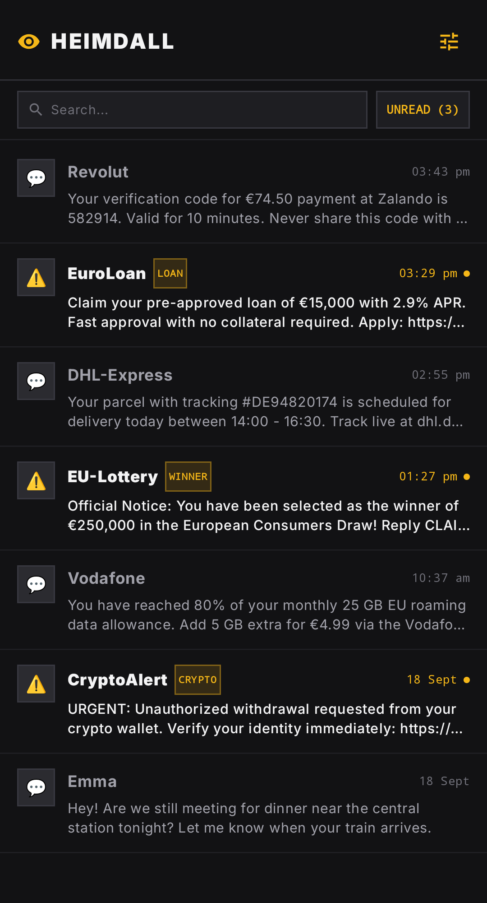
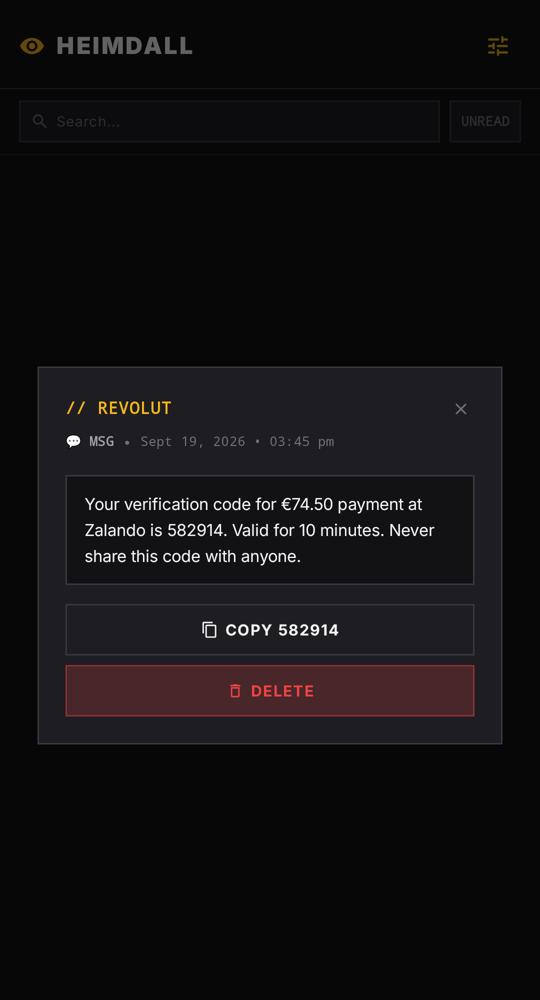
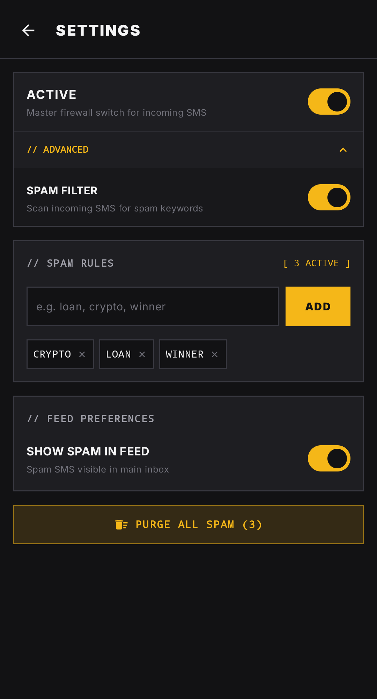

# Heimdall 👁️🛡️

An Android SMS app that silently intercepts spam before it reaches your phone's message database—keeping your inbox clean even if you switch apps.

  
  
  

## 🎭 How It Works

Most spam blockers just move spam into a folder—it still lives in your phone's SMS database, shows up if you switch messaging apps, and gets backed up to the cloud.

Heimdall drops spam **before** it is ever saved. When a message matches your blocklist, it is silently discarded—no notification, no vibration, and it **never touches the system SMS database**. Real messages pass through normally. If you ever switch back to Google Messages, your inbox is already clean.

## ✨ Features

- 🛡️ **Pre-Storage Spam Drop** — Blocked messages never reach Android's SMS database or wake your screen.
- 🔒 **100% Offline** — Zero internet permission. No data ever leaves your device.
- 🎯 **Custom Keyword Rules** — Block any word or phrase, in any language, with built-in anti-evasion filters.
- 🔑 **1-Tap OTP Copy** — Copies verification codes from notifications with a single tap and auto-dismisses the alert.
- 🏷️ **Smart Tags** — Organizes clean messages into Bank, Card, Delivery, Travel, and OTP categories.

> 📖 For a detailed feature breakdown and comparison with other apps, see the [Features & Comparison Guide](docs/features.md).

## 📦 Installation

Install via F-Droid for seamless setup and automatic updates:

> 📖 Looking for direct APK downloads, Obtainium, or building from source? See the [Installation Guide](docs/installation.md).

## 💡 Feedback & Feature Requests

Have a suggestion or found a bug? Please [open an issue](https://github.com/monkeyscript/heimdall/issues)—feedback and contributions are always welcome!
